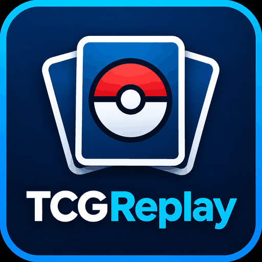

<p align="center"></p>

# tcgreplay

A virtual Pokémon TCG playmat that an AI assistant drives over MCP. Paste a
Pokémon TCG Live battle log and the assistant rebuilds the game on a live board,
steps through your turns with you, rewinds to the decisions that mattered, plays
out better lines, and turns your mistakes into drills. You can also just play a
game against it.

It is a **playmat, not a rules engine**. The board is plain data, so any
position can be built, rewound or branched; the assistant polices legality, and
the server only checks that cards are where it says they are. Card text and
images come from [TCGdex](https://tcgdex.dev), and the assistant quotes card
text from there rather than from memory.

## What it does

- **Imports TCG Live battle logs** into a game you can step through turn by
  turn, filling in the opponent's unseen cards with a likely 60-card list built
  from what they showed.
- **Reviews a game with you.** The assistant asks why you made notable plays
  before giving its view, rates decisions apart from outcomes (a good play that
  lost is still good), and records strengths as well as errors.
- **Rewinds and branches.** Go back to any decision, try another line on a
  branch, and compare the boards. Sample the opponent's hidden hand several
  times to test a line against more than one draw.
- **Drills the concepts** behind your mistakes: positions that capture the
  idea, not the exact game, for you to play and be graded on.
- **Plays against you** in play mode, without peeking at your hidden cards.
- **Shows a live board** in the browser. You can watch the assistant move cards
  and make moves yourself by dragging.

## Using it

### Hosted

The hosted playmat is at **https://tcgreplay.demo.gs**. Sign-in is with Google,
and each account gets its own game. Games are dropped after an hour without
activity and on every deploy, so keep the record (`get_record`) of anything you
want to come back to.

Add it to your assistant as a remote MCP server at
`https://tcgreplay.demo.gs/mcp`. Your assistant opens a Google sign-in the
first time.

- **claude.ai**: Settings → Connectors → Add custom connector, and enter the
  address.
- **Claude Code**: `claude mcp add --transport http tcgreplay https://tcgreplay.demo.gs/mcp`
- **ChatGPT**: Plugins → Add → Add custom MCP server, enter the address and
  leave authentication on OAuth. The guides were written with Claude in mind,
  so expect some rough edges.

Every game result carries a board link. Open it in a browser to watch and play.

### On your desktop

Build and install the binary (needs Go and Node):

```sh
make install
```

Then add it to the Claude desktop app's MCP settings
(`claude_desktop_config.json`), with the path `go install` put it at:

```json
{
  "mcpServers": {
    "tcgreplay": { "command": "/home/you/go/bin/tcgreplay" }
  }
}
```

Restart the app. The board is at http://127.0.0.1:7777. The desktop app may
start several copies of the server, so it runs one background daemon that owns
the game and the board, and every copy relays to it. The board survives app
restarts. There's no sign-in on the desktop, and one game at a time.

## Example prompts

**Import and review a game**

> Here's my last game from TCG Live: *(paste the battle log)*

> Review this game with me. Start with the turn where I lost tempo.

> Why do you think Boss's Orders on turn 4 was a mistake? What would you have
> done instead?

> Take me back to my third turn and show me the line where I bench Pidgey
> first.

> Try that line against a few different opponent hands. Does it still work?

**Understand the opponent**

> What was my opponent probably playing? Build their likely list.

> What could they have had in hand when they passed on turn 3?

**Drills and practice**

> Give me a drill based on the mistakes from my last few reviewed games.

> Quiz me on damage maths for the cards in this game.

> Let's practise my before-you-move checklist on this position.

**Play a game**

> Let's play. Here's my deck: *(paste a TCG Live decklist)*. You play Gardevoir.

> Set up a position where I have Charizard ex active against a Gardevoir ex
> with two Psychic Energy, and let me play it out.

**Card questions**

> What does Pidgeot ex's Quick Search do exactly?

The assistant follows built-in guides for these workflows (`import-game`,
`opponent-deck`, `review-game`, `replay-drill`, `before-you-move`,
`numbers-drill` and `play-game`), so the plain request is enough.

## Development

```sh
make build   # build the board UI and the binary into bin/tcgreplay
make test    # Go vet and tests, then the board's browser tests
make dev     # run a dev daemon beside the installed one (board on :7778)
make dev-ui  # board with hot reload, proxying to the dev daemon
```

`.mcp.json` points Claude Code at the dev build as `tcgreplay-dev`.

The hosted playmat runs the same binary with `-hosted` in a container
(`make docker-build`, `make docker-run`; deployed from `.do/app.yaml`). It adds
Google sign-in, per-account games, rate limits and, optionally, a DigitalOcean
Spaces bucket that keeps the card cache across deploys and serves card images
from its CDN. Its settings are documented in `.do/app.yaml` and in the
comments above `docker-run` in the `Makefile`.

Design notes are in [TCG Review Playmat Design and Build Plan.md](TCG%20Review%20Playmat%20Design%20and%20Build%20Plan.md).
